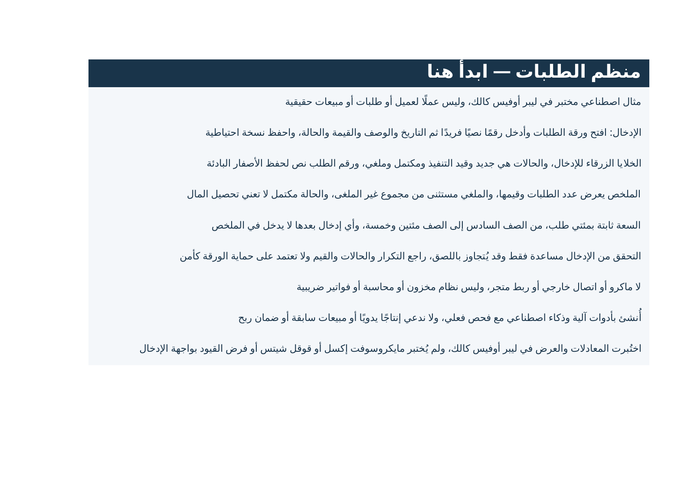
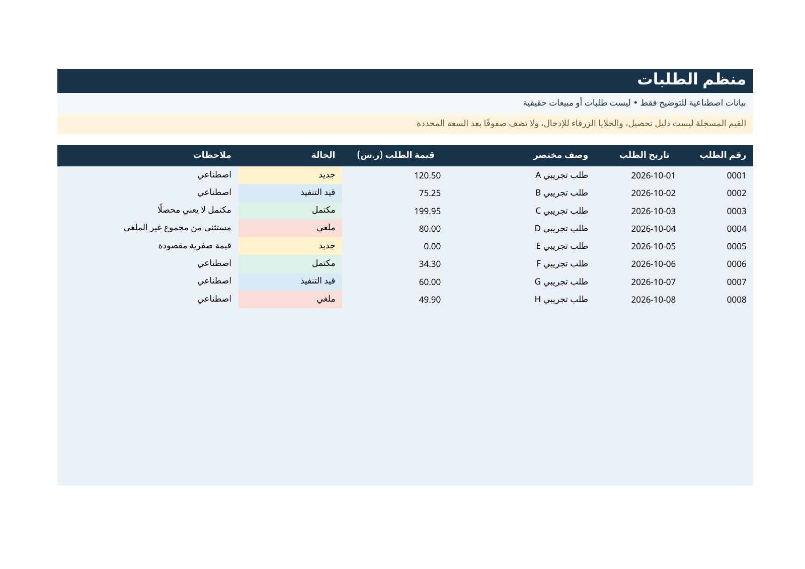
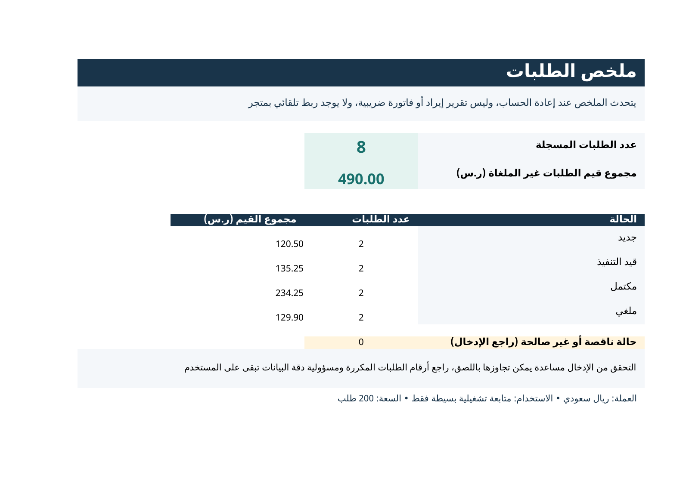

# منظم الطلبات العربي — معاينة ثابتة

Arabic Orders Organizer — static preview and documentation.

معاينة من أصل جدول عربي لتنظيم الطلبات، أُعد بمساعدة أدوات آلية وذكاء اصطناعي (AI-assisted). الغرض هنا مراجعة الواجهة العربية وRTL، والحقول والحالات وحدود الاستخدام. ليست قصة عمل عميل أو دليل بيع أو دخل، وليست متجرًا أو بوابة دفع.

## شاهد المعاينة

الصور التالية من المثال الاصطناعي نفسه، وليست ثلاثة منتجات مختلفة:

### التعليمات والإفصاح

### ثمانية طلبات اصطناعية

### الملخص التشغيلي

يمكن فتح الصور منفردة أو تنزيل ملفات هذا المستودع مجانًا من Code → Download ZIP. التنزيل هو معاينة صور ووثائق فقط: لا يحتوي ملف XLSX القابل للتحرير أو صيغ القالب الكامل.

## ما الذي يوضحه الأصل؟

- إدخال يدوي لرقم طلب نصي وتاريخ ووصف وقيمة وحالة وملاحظات.
- أربع حالات: جديد، قيد التنفيذ، مكتمل، ملغي.
- سعة محددة 200 طلب في الصفوف 6–205؛ لا توسع تلقائي.
- ملخص عدد الطلبات والقيم حسب الحالة، مع استثناء الملغي من مجموع غير الملغى.
- ليس نظام مخزون أو محاسبة أو فاتورة ضريبية، ولا يوجد ربط تلقائي بمتجر أو ماكرو أو اتصال خارجي في الأصل المفحوص.
- حالة «مكتمل» لا تعني قبض المال. جميع الأرقام المعروضة اصطناعية وليست إيرادًا.

## حدود الفحص

توجد في المشروع الأصلي فحوص سابقة للمعادلات والعرض في LibreOffice Calc 7.4.7.2. هذه ليست اختبارات Microsoft Excel أو Google Sheets، ولم يُتحقق من فرض قيود الإدخال والحماية عبر واجهتهما. لم تُعَد فحوص الحساب في نشر هذه المعاينة؛ الصور نفسها لا تثبت التشغيل أو التوافق.

التحقق من الإدخال مساعدة يمكن تجاوزها باللصق، وحماية الورقة ليست أمنًا. [الملاحظات التقنية](TECHNICAL-NOTES.md) توضح النطاق والأرقام التجريبية.

## ملاحظات على المعاينة

نرحب بملاحظة فنية أو لغوية محددة تخص هذه المعاينة في Issues لهذا المستودع فقط. لا ترفق بيانات عملاء أو معلومات شخصية أو أسرارًا أو وسائل دفع. لا يوجد نموذج يجمع معلومات، ولا طلب تحويل أو شراء أو اشتراك هنا. وجود ملاحظة لا يعني طلب شراء أو اتفاقًا ملزمًا.

للاحتياج العملي، فتحنا [سؤال استخدام اختياريًا](https://github.com/aims1425-lab/arabic-orders-preview/issues/1): هل يناسبك الإدخال اليدوي وسعة 200 طلب، وش البرنامج اللي تستخدمه، وهل تحتاج نسخة قابلة للتحرير إذا توفرت لاحقًا؟ الردود عامة؛ وصف الاستخدام يكفي بلا بيانات شخصية. السؤال من صاحب المشروع لاختبار الحاجة والتوافق، وليس طلب شراء من عميل أو حجزًا أو وعد تسليم. لا نعدّ star أو مشاهدة المعاينة نجاحًا تجاريًا.

يدير النشر Jarvis، مساعد AI مفوض من صاحب الحساب؛ لا ندعي إنتاجًا يدويًا أو خبرات عملاء أو نتائج مبيعات.

## الحقوق

[نطاق الاستخدام والإفصاح](RIGHTS.md). النشر العام يسمح بالمشاهدة وfork داخل GitHub وفق شروطه، ولا يمنح حصرية أو حق إعادة بيع الملف الكامل غير المنشور. لا ترخيص مفتوح المصدر للقالب الكامل هنا، ولا ادعاء احتكار معادلات عامة أو ضمان حقوق حصرية لمخرجات AI.

## English summary

Static screenshots and documentation of an AI-assisted Arabic order-tracking workbook. All displayed orders are synthetic. This repository is for preview feedback, not a checkout or paid download. The editable workbook and full formula implementation are not included. Historical checks were limited to LibreOffice Calc; Excel and Google Sheets compatibility is untested. A completed order is not proof of payment. No earnings, sales, previous-client, or human-made claims are made.
